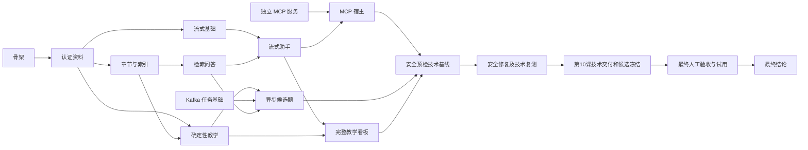

# OpenSpec 实现推进、专项安全与最终验收审计

## 变更说明

2026-11-05 用户要求检查全部 OpenSpec：功能实现只做自动化运行与错误回归，人工测试集中到全部功能齐备后的最终验收，专项安全测试与审计由独立变更负责；随后补充要求明确功能组前后依赖，确保可以持续推进。本轮范围为规划与相应规则/README 同步，未实现业务代码、修改测试断言、门禁命令或运行配置。工作区保留前一轮尚未提交的骨架/认证收尾差异。

使用 `openspec-update-change`，以 CLI `status --change <name> --json` 定位 12 个活动变更的既有制品；使用 `project-review` 对照根规则、README、测试/评审规范、受影响规划和课程原文。7 个功能变更的 proposal/design/tasks 明确实现交付、直接依赖、输出及并行边界；安全预检、安全修复、第 10 课及最终验收同步责任和时序。没有将待执行任务勾选通过，没有创建新业务能力规格。

## 课程来源与对照

网络浏览工具无法打开页面、沙箱内域名解析失败；获准读取公开网站后，通过 Python 标准库实际取得下列三页，提取正文至本机临时目录。判断依据为本轮原文，不以旧文档中的课件推测代替。

| 来源 | 本轮核对范围与修正 |
| --- | --- |
| [第 8 课任务清单](https://devops.hello1023.com/课程任务清单-第8课.html) | 此页是异步任务后的安全自查，归安全预检。保留两班身份、接口清单、SEC-01–07、真实红绿、明文密钥即时处置、固定报告与扫描入口。功能实现原异步 7.1–7.3 移交专项，不回流成为 7.4 完成条件。同伴至少两条跨机器复验保留到最终验收 4.1。SEC-08 本课仅选做准备素材，不能提前把四步实验写成已执行。 |
| [第 9 课任务清单](https://devops.hello1023.com/课程任务清单-第9课.html) | 安全修复沿原三段式复测、优先处理真实红项；保留授权、SQL/XSS/CSRF 三件套、资产、审计、红绿门禁、异步回归与返工记录。原 SEC-08“选做且不执行也可通过”不符合该页，修为必做四步，缺项必须保留失败/未执行。真人观察和同伴复验集中到最终验收 4.2–4.3，技术脚本仍归安全修复。 |
| [第 10 课任务清单](https://devops.hello1023.com/课程任务清单-第10课.html) | 保留场景矩阵、四项技能、双门禁/CI、红绿演练、容器与制品追溯、三张技能面板和真实告警、同口径压测改进、高风险三查及固定证据。三名真实试用与独立四步归最终验收 4.4–4.5，人工意图确认归 1.3。5.1 只依赖技术交付后冻结候选，不能先要求该候选的真人试用通过。 |

基本业务授权、参数/类型校验、事务、幂等、答案开放及故障回归是功能正确性，继续实现与自动化验证。工具调用记录等产品审计功能保留。跨功能独立攻击矩阵、SSRF/DNS 绕过专项、资产扫描取证、移除授权/发布检查的破坏验证集中到安全预检 1.3，实际发现交安全修复，不在功能任务中重复增加专项验收。已启用的扫描与门禁仍照常运行，不因调度修订跳过失败。

## 功能依赖审计

每个功能 tasks 已增加「推进依赖」，明确到任务组的输入、输出、可并行关系及阻塞范围。以下为本轮核对后的主链；纳入交付的可选能力才加入最终收口。

- 章节迁移后即可推进人工建题、测验和确定性评分，不等待完整检索、模型、Kafka 或 MCP；Kafka 任务基础也可并行。
- 最小 SSE、配置和迁移先依赖认证基线，接真实证据时才要求检索/问答接口，已修正流式 1.1 先要求完整 QA 的过宽前置。
- 候选题使用有限证据接口和固定练习提示配置，不依赖完整通用应用目录或 MCP。看板可先交付测验指标，反馈计数待流式反馈接通后完成，不能用假 0 冒充。
- 后台索引是选做；选做时依赖核心闭环及已实现发布服务。主规格同步是归档前置，不是所有功能编码前置。
- 安全预检依赖已交接的功能，安全修复依赖真实技术基线；两者的真人独立复验后移最终验收，不反向阻断技术交接。
- 开发候选可作为下游输入。实际同伴代码评审仍是合并前提，与实现交付、最终人工测试分开；没有人工批准不得自行合并。

课程清单要求作业提交 202、教师改分优先等行为；当前产品明确的正式提交 201、候选题 202、教师审题和 Cookie 登录并不自动等价。相关路径、状态和待补能力已在最终验收 1.5 与第 10 课设计集中列出。未取得正式课程口径前保留验收缺项，不能通过更改任务归属将它们变成通过；也不因此暂停已明确契约的独立功能开发。

## 验证记录

- 通过 OpenSpec CLI 读取全部 12 个活动变更的实际路径及 schema，未使用历史会话替代磁盘状态。
- 首次严格校验：11 通过、1 失败；新增安全预检 1.3 错置在第 3 组。将其移回第 1 组后，`openspec validate --all --strict` 退出 0，12 项通过。原有两项 MODIFIED 上游未归档提示保留，是归档顺序提醒，不是本轮运行成功证明。
- `UV_CACHE_DIR=/private/tmp/campusclaw-uv-cache make check-static` 退出 0，含全量严格校验、格式、Ruff、分层与场景映射；日志在忽略目录 `reports/2026-11-05-openspec-audit/check-static.log`。
- 临时审计脚本对明确列出的 19 个阶段、26 条直接依赖边执行拓扑检查，无环；检查 7 份功能依赖表及本轮修改 Markdown 的相对链接。输出 `reports/2026-11-05-openspec-audit/dependency-check.json`。这是对文档依赖模型的检查，不是程序运行证据。
- `git diff --check` 检出文档末尾多空行，整理后复测退出 0。任务状态未因本轮规划调整写成测试已执行。
- 本轮没有新增代码行为，应用 pytest、Compose、真实安全扫描、人工测试、用户试用及新远程 CI 均未执行，不引用前轮运行结果冒充本轮结果。

## 评审结论

规划与文档自检通过；功能任务的技术交付、安全专项和真人验收职责已明确，主要推进依赖无循环。尚未实施能力保持原待办，转移的人工任务在最终验收继续未勾选。约束文档同步原因是用户明确调整工作分工，影响限调度和实现完成口径，原授权、数据与合并门禁边界保留。约束内容仍待最终验收 1.3 实际人工复核，本轮助手自检不作批准。审计完成时尚未提交、推送、合并、归档或发布；后续用户授权的提交记录见下节。

## 用户授权后的分组提交

用户随后明确要求细化提交并推送远程。沿用 `change/2026-11-05-close-foundation`，按以下目的拆分，既有钩子保持启用：

- `463c8c01afe9ff2a65c712ae54d79bbc3c314f24`：交接反例自动化回归。
- `e47e5ad080833114fc49f0141cfd4c40a9dbf550`：第 8/9 课安全专项规划。
- `f6acf69f08bd7a5004b3260165406cdca5a00f37`：最终验收调度与场景追溯。
- `6cdb05b1f7ec6f932b1c99da1740221421bc2a86`：功能依赖与骨架/认证收尾。

协作规则、README 与本审计汇总另作第五个提交。提交前再次执行 `UV_CACHE_DIR=/private/tmp/campusclaw-uv-cache make check-static` 及 `git diff --check`，退出 0；新增 CK-F08 专项 pytest 复测 1 项通过（18 项未被选择）。推送只更新当前变更分支，实际远端结果以 Git 操作与引用核验为准，不代表合并、人工批准或课程通过。
